# Установка и настройка

## Меню настроек

Это главное меню устройства Ватериус.

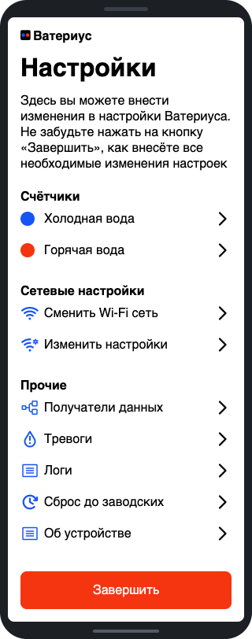

## Что понадобится

- Телефон.
- Имя и пароль домашней сети Wi-Fi 2,4 ГГц.
- Аккаунт на [waterius.ru](https://waterius.ru), если показания пойдут туда.

## 1. Подключите счётчики

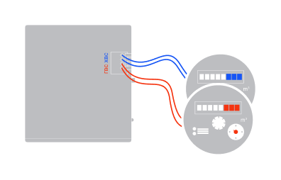

- Холодная вода: правые разъёмы (ХВС).
- Горячая вода: левые разъёмы (ГВС).

Закрепите провода. Они не должны шевелиться.

В портале холодная вода это **синий вход**, горячая это **красный вход**.

## 2. Включите режим настройки

1. Установите батарейки.
2. Держите кнопку дольше 4 секунд и отпустите.
3. Подключите телефон к сети `waterius-<номер>-<версия прошивки>`. Пароля нет.
4. Страница откроется сама. Если нет, наберите `http://192.168.4.1`.

Без действий режим настройки закроется через 10 минут.

## 3. Подключите Ватериус к домашней сети

1. Нажмите **«Начать»**.
2. Выберите сеть. Если её нет в списке, нажмите «Ввести название вручную».
3. Введите пароль и нажмите «Сохранить».

<table>
<tr>
<td align="center">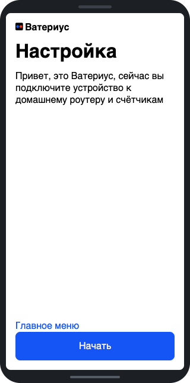 Приветствие</td>
<td align="center">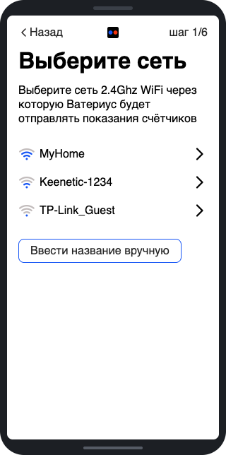 Выбор сети</td>
<td align="center">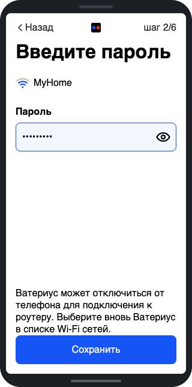 Пароль</td>
</tr>
</table>

Телефон может потерять связь с Ватериусом. Тогда снова выберите его сеть в списке Wi-Fi.

## 4. Настройте счётчик холодной воды

1. **«Синий вход»**: выберите, что считает вход, и тип счётчика. Обычно менять ничего не надо. Нажмите «Сохранить».
2. Спускайте воду в унитазе. Ватериус сам перейдёт дальше. Обычно нужно слить 5-10 литров. Если страница не меняется, проверьте провода.
3. Введите показания и нажмите «Сохранить». Серийный номер не обязателен.

<table>
<tr>
<td align="center">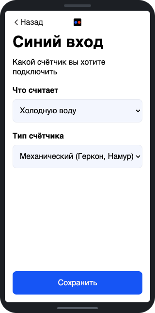 Что считает вход</td>
<td align="center">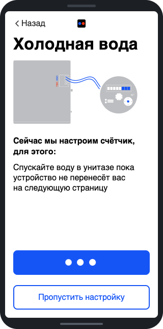 Проверка импульсов</td>
<td align="center">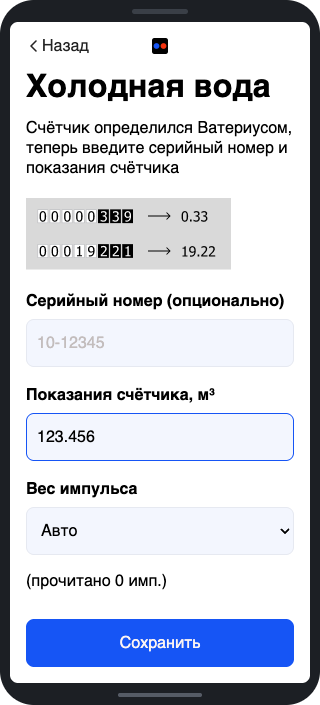 Показания</td>
</tr>
</table>

**Показания.** Формат: `123.456`. Кубометры, точка, литры. Без литров показания не примут. Если литров ноль, введите `123.000`.

**Вес импульса.** Это литры на один импульс. Если он есть в паспорте счётчика, выберите его: 1, 10 или 100 л.

В режиме «Авто» Ватериус считает импульсы холодной воды за время настройки:

- 3 импульса или меньше: 10 л.
- Больше 3 импульсов: 1 л.

Пока идёт настройка, не пользуйтесь холодной водой.

## 5. Настройте счётчик горячей воды

После показаний холодной воды Ватериус сразу перейдёт к горячей воде, на страницу **«Красный вход»**.

Шаги те же. Только вместо унитаза откройте кран горячей воды.

<table>
<tr>
<td align="center">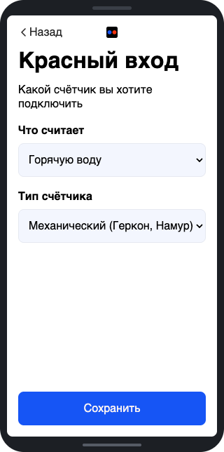 Красный вход</td>
<td align="center">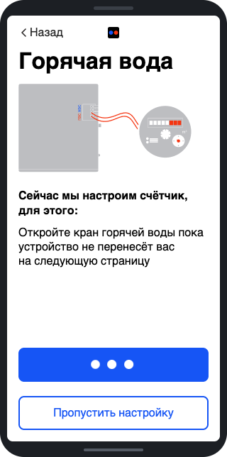 Проверка импульсов</td>
<td align="center">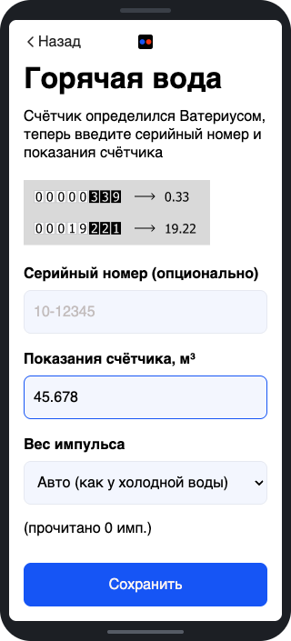 Показания</td>
</tr>
</table>

Если второго счётчика нет, выберите тип «Выключен».

## 6. Укажите, куда отправлять показания

После горячей воды откроется страница **«Отправка показаний»**. В меню она называется «Получатели данных».

- **Waterius.ru**: введите почту аккаунта.
- **Сервер HTTP** или **MQTT**: см. [Export.md](Export.md).
- **Home Assistant**: см. [Home_Assistant_setup.md](Home_Assistant_setup.md).

**Период отправки** задаётся в минутах. 1440 минут это раз в сутки.

Нажмите «Сохранить», а затем обязательно кнопку **«Завершить»** в меню.

<table>
<tr>
<td align="center">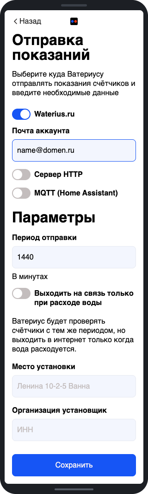 Получатели данных</td>
<td align="center">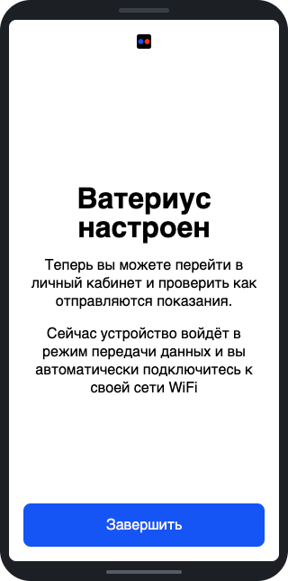 Настройка закончена</td>
<td></td>
</tr>
</table>

Светодиод будет пульсировать, что означает подключение. Если светодиод заморгает, то это говорит об ошибке: [коды ошибок](#светодиод-после-сеанса-связи).

## 7. Проверьте связь

Откройте личный кабинет [account.waterius.ru](https://account.waterius.ru). Ватериус должен появиться в личном кабинете.

Дальше он будет слать показания сам, раз в заданный период. Первый раз будет погрешность, а затем часы синхронизируются и точность будет до минуты. Если нужно пробуждение в заданное время - нажмите через 2 дня кнопку в это время.

## Что ещё есть в портале

Чтобы вернуться в меню, держите кнопку дольше 4 секунд и подключитесь к сети Ватериуса.

- **Изменить настройки**: статический IP, режим Wi-Fi, MAC-адрес, NTP сервер.
- **Тревоги**: см. [Alarms.md](Alarms.md).
- **Логи**: журнал с момента входа в настройку. Его можно скачать.
- **Об устройстве**: версии прошивок.
- **Сброс до заводских настроек**: удаляет настройки и обнуляет показания.

<table>
<tr>
<td align="center">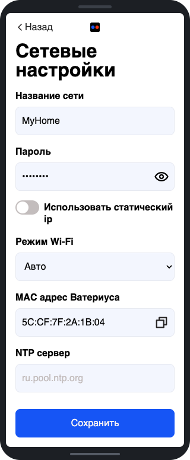 Сетевые настройки</td>
<td align="center">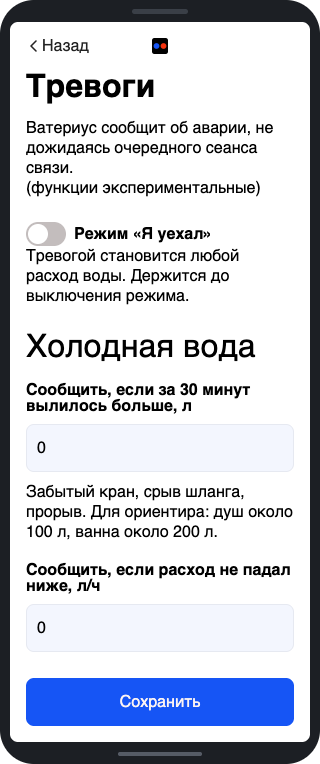 Тревоги</td>
<td align="center">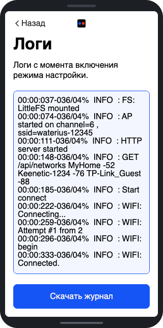 Логи</td>
</tr>
<tr>
<td align="center">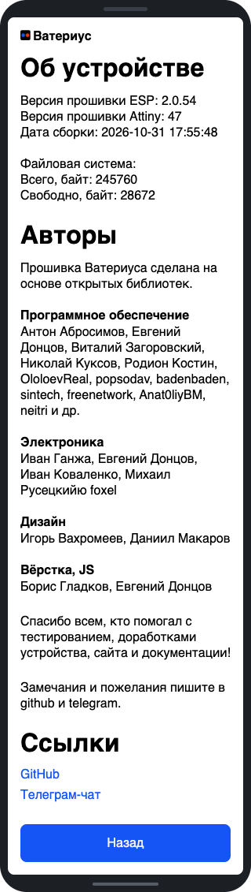 Об устройстве</td>
<td align="center">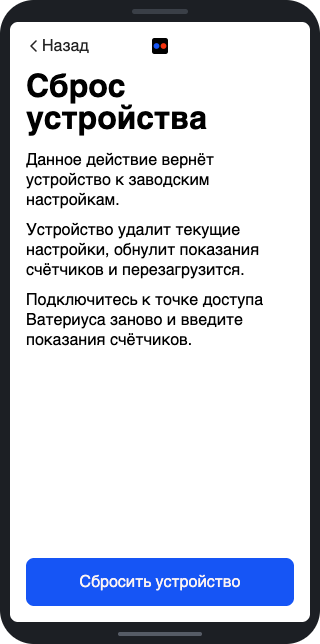 Сброс</td>
<td></td>
</tr>
</table>

## Тип счётчика

- **Механический (Геркон, Намур)**: геркон, сухой контакт или NAMUR. Подходит большинству счётчиков воды.
- **Электронный**: счётчики с электронным табло. Обычно счётчики газа, тепла, электричества. Импульс очень короткий (от 1 мс у Гранд).
- **Протечка (нормально-разомкнутый)**: датчик воды на полу. Тревога, когда вода замкнула электроды. Обрыв провода не виден.
- **Протечка (нормально-замкнутый)**: датчик воды на полу. В норме шлейф замкнут перемычкой или резистором 5,6 кОм. Обрыв провода это тоже тревога. Подходит для длинного провода.
- **Выключен**: вход не используется.

На входе с датчиком протечки показаний нет.

Оба типа датчика протечки и страница «Тревоги» будут работать при прошивке attiny версии 44 и новее. Прошивка attiny обновляется программатором ([Firmware.md](Firmware.md)).

Подробнее о тревогах: [Alarms.md](Alarms.md).

### Электричество

1. Включите электроприбор.
2. Дождитесь моргания светодиода счётчика. Следующая страница откроется сама.
3. Выберите модель счётчика или укажите число импульсов на кВт·ч.

Если страница не открывается, проверьте подключение. Возможно, счётчик не поддерживается.

<table>
<tr>
<td align="center">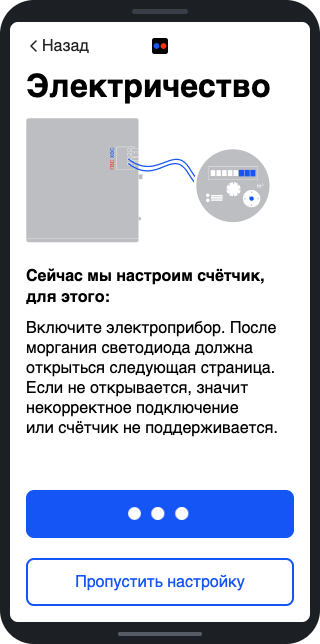 Проверка импульсов</td>
<td align="center">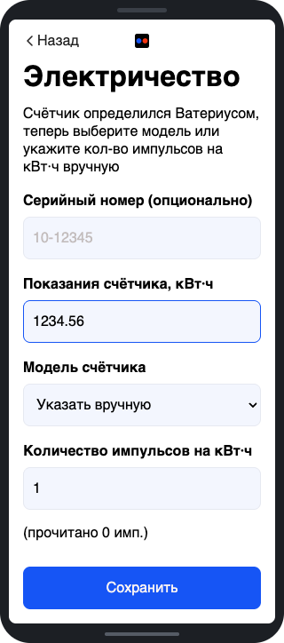 Модель и показания</td>
<td></td>
</tr>
</table>

### Газ и тепло

Импульса можно ждать долго. Нажмите «Пропустить настройку».

## Выходить на связь только при расходе

Переключатель на странице «Получатели данных». По умолчанию выключен. Нужна прошивка ЕСП 2.0.47 или новее.

Режим экономит батарейку при коротком периоде. Больше всего её тратит Wi-Fi.

Режим рекомендуется для счётчиков тепла, ведь полгода они отключены и расхода нет.

Как работает:

1. Ватериус просыпается с заданным периодом.
2. Импульсы изменились: идёт обычный сеанс связи.
3. Не изменились: Wi-Fi не включается.
4. Без расхода Ватериус выходит на связь раз в 3 суток.

Сеанс по кнопке и по тревоге идёт всегда. Импульсы считаются и в молчании.

Что учесть:

- **Команды с сервера, по MQTT и из Home Assistant доходят только в сеансе связи.** Без расхода это до 3 суток. Чтобы применить сразу, нажмите кнопку коротко.
- **Режим «Я уехал» включайте до отъезда** ([Alarms.md](Alarms.md#режим-я-уехал)).
- **Тревога «остановка расхода» может опоздать на 3 суток.** Остальные тревоги приходят без задержки.

## Светодиод после сеанса связи

Если сеанс не удался, Ватериус моргает перед сном. Сначала светодиод гаснет на треть секунды. Дальше считайте вспышки:

| Вспышек | Что случилось |
|---|---|
| 1 | Показания отправлены, но просело питание (только Ватериус2) |
| 2 | Не подключился к вашей Wi-Fi сети |
| 3 | Не достучался до сервера |
| 4 | Не подключился к MQTT-брокеру |
| 5 | Не прочитались настройки или нет связи с микроконтроллером |
| 6 | Сервер ответил, но отказался принять показания |

Успешный сеанс не моргает. Если ошибок несколько, показывается первая.

## Если не получилось

- **Сети нет в списке.** Ватериус видит только сети 2,4 ГГц.
- **Ватериус не подключился к роутеру.** Откроется страница сетевых настроек. Проверьте имя сети и пароль. Подробности на странице «Логи».
- **Роутер GPON МГТС.** Попробуйте статический IP вместо DHCP.
- **Страница проверки импульсов не меняется.** Проверьте провода. Или нажмите «Пропустить настройку» и вернитесь к этому позже.

Другие вопросы: [FAQ.md](FAQ.md).
